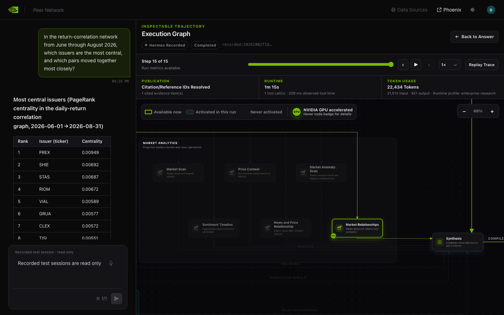
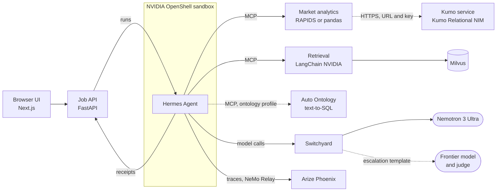

# GPU Market Analysis Agent

| Catalog field | Value |
| --- | --- |
| Description | Answers market research questions with a Hermes agent in an OpenShell sandbox that calls RAPIDS market analytics, document retrieval, text-to-SQL and Kumo prediction, citing each tool call and showing its live execution graph and CPU/GPU speedups. |
| Industry | 💳 Financial Services |
| Requirements | Linux or macOS · Docker Engine 28+ with Compose 2.30+ · build.nvidia.com API key · NVIDIA GPU optional (RAPIDS tier) · replay needs no key or GPU |
| NemoClaw | N/A |
| Harness | Hermes 0.21.5 |
| OpenShell | 0.1.2 |

You ask a question about a market. A Hermes agent in an OpenShell sandbox plans the work and calls tools: market
analytics on RAPIDS cuDF, cuML and cuGraph (pandas on a CPU), Kumo predictions, text-to-SQL with Auto Ontology,
and retrieval over SEC filings and regulations with Nemotron embedding and reranking. Every model call goes
through NeMo Switchyard, which serves Nemotron 3 Ultra and can hand a session to a frontier model when a judge
model asks for one. The answer cites the tool calls behind it, and each citation opens the data that call
returned. The UI draws the run as a live graph of every model and tool call, measures each market tool call on
the CPU and the GPU, links its trace in Arize Phoenix, and replays recorded runs without keys or a GPU.

The stack runs Hermes and OpenShell directly, with Docker Compose and one lifecycle script; it does not use the
NemoClaw CLI. The default data pack, `synthetic-market`, is a fictional market of 2,000 issuers written with NeMo
Data Designer and Nemotron. It builds with nothing to fetch and names no real company.

## Screenshot



A recorded `synthetic-market` session in replay. The question and its ranked answer are on the left. The
execution graph on the right shows the one market tool the agent called (`analyze_market_relationships`, badged
as GPU accelerated), the synthesis step, and the run's citations, runtime and token use.

## At A Glance

| Question | Answer |
| --- | --- |
| Category | Field Demo |
| Contributor or provenance | NVIDIA |
| Use this when | You want to show an agent that reasons over market data and documents inside a sandbox boundary, with every answer traced to the tool calls behind it and GPU speedups measured on the spot. |
| You will get | A web UI with featured questions, cited answers, a live execution graph, per-call CPU/GPU benchmarks, Phoenix traces, and a replay mode over recorded sessions. |
| Runs on | Linux with kernel 6.2 or later, or macOS with colima. The GPU tier needs Linux x86_64 with an NVIDIA GPU and the NVIDIA Container Toolkit. |
| Requires | Docker Engine 28+ with Compose 2.30+, bash, curl, an `nvapi-` key from [build.nvidia.com](https://build.nvidia.com), and a name and email for SEC EDGAR. Optional: an NVIDIA GPU, a [Kumo service](docs/kumo-service.md), and the Auto Ontology submodule. |
| Verified on | The same stack, every profile, on a Brev VM with an NVIDIA A100 40 GB (Ubuntu 22.04, kernel 6.8, Docker 29.8) and on an NVIDIA B200 host, October 2026. |
| Evidence level | live end-to-end |
| Support and maturity | Field demo. Best-effort community support; see [SUPPORT.md](../../../../SUPPORT.md). |
| External access, data, and actions | Questions, tool results and documents go to the configured inference and retriever endpoints (build.nvidia.com by default), billed to your key. The first `up` downloads SEC EDGAR filings, eCFR Title 17 and a Federal Register rule. Kumo questions send sampled pack data to the Kumo service you configure. Nothing is written outside the Docker volumes and this directory. |
| Start here | [Quickstart](#quickstart) |
| Confirm success | [Verification](#verification) |

## Quickstart

Run every command from this example's directory:

```bash
cd examples/demos/field/market-analysis
```

### Replay, with no key or GPU

```bash
./scripts/demo.sh replay
```

Open `http://127.0.0.1:3100`. The UI serves the recorded `synthetic-market` sessions: answers, citations,
execution graphs and Benchmark tabs, with no API, model calls or GPU.

### The full stack

**Before you start:** `up` sends your questions, tool results and retrieved passages to the inference and
retriever endpoints in `.env`, and the calls are billed to the key you set. It also downloads about 1.4 GB of SEC
EDGAR filings and embeds them through the retriever endpoint.

```bash
./scripts/demo.sh init    # creates .env and its internal secrets (mode 600)
"${EDITOR:-vi}" .env      # set INFERENCE_API_KEY and SEC_USER_AGENT
./scripts/demo.sh up      # builds, prepares the data, starts everything
./scripts/demo.sh check   # proves the sandbox boundary
```

In `.env`, `INFERENCE_API_KEY` is your `nvapi-` key, which also serves the retriever, and `SEC_USER_AGENT` is a
name and an email for SEC EDGAR (`Jane Doe jane@example.com`). Edit `.env` in an editor: keep keys off command
lines. Then open `http://127.0.0.1:3100` and pick a question. The first `up` took about 45 minutes with every
profile on an A100 VM; later runs reuse the images, the downloads and the index.

The defaults run on a CPU (`COMPOSE_PROFILES=core,retrieval,analytics`). On a Linux host with an NVIDIA GPU, use
`analytics-gpu` instead of `analytics` for the RAPIDS tools and the Benchmark tab's CPU/GPU comparison. For the
Auto Ontology questions, check out its submodule, then add `ontology` to `COMPOSE_PROFILES`:

```bash
git submodule update --init --checkout vendor/auto-ontology
```

For the Kumo questions, set `KUMO_RELATIONAL_URL` and `KUMO_API_KEY` to a [Kumo service](docs/kumo-service.md),
which runs on a GPU host of its own. [Configuration](docs/configuration.md) covers every variable, profile and
hardware tier, and [operations](docs/operations.md) covers everything after `up`, including a
[Brev VM](docs/operations.md#brev-vm-mode).

## Verification

**Evidence level:** live end-to-end

```bash
./scripts/demo.sh check
```

**Expected result:**

```text
PASS  the receipt key in the sandbox is an OpenShell placeholder
PASS  egress to a host outside the policy is blocked
PASS  Switchyard GET /v1/models is allowed
PASS  Switchyard POST /v1/responses is denied by policy
PASS  the job API's public routes are denied by policy
PASS  market analytics' POST /benchmark (the API's) is denied by policy
PASS  the plugin's GET .../execution-scope reaches the job API
PASS  the plugin's POST .../tool-receipts reaches the job API
PASS  the plugin's POST .../llm-calls reaches the job API
```

Then ask a featured question in the UI. The run completes with an answer that cites its tool calls, the
execution graph highlights each tool the agent called, and, on `analytics-gpu`, the Benchmark tab reports the
CPU and GPU timings of each market tool call. `./scripts/demo.sh status` lists the services, the sandbox and
Switchyard's routes.

**This verifies:** the sandbox runs with its policy (blocked egress, a placeholder for the receipt key, only the
routes the agent needs), and the stack answers questions end to end through Switchyard and the tools.

**This does not verify:** answer quality, which depends on the model and the question, or a GPU speedup on
hardware other than the hosts above. The Benchmark tab claims a speedup only when every one of its CPU/GPU pairs
favors the GPU and both engines return the same payload.

## Architecture



| Directory | What it holds |
| --- | --- |
| `agent/` | The Hermes profile, skills, receipts plugin, sandbox image and policy |
| `api/` | The job API (`demo_api`); its Pydantic models are the event and receipt contracts |
| `ui/` | The Next.js UI, derived from the [AI-Q blueprint UI](https://github.com/NVIDIA-AI-Blueprints/aiq) |
| `tools/` | The MCP servers, `market-analytics` and `retrieval`, and the Auto Ontology patches and seed |
| `infra/` | The OpenShell pins, the Switchyard image and routes, Phoenix, and the separate Kumo service recipe |
| `data/` | The data packs and the `demo-data` builder; `data/generate` writes the synthetic text |
| `contracts/` | The tool registry and the JSON Schemas the services share |
| `scripts/` | `demo.sh`, the lifecycle, and `gen-contracts.sh`, which regenerates the contracts |

## Credentials And Security

- Keys live only in `.env`, which `init` creates with mode 600 and Git ignores.
- Switchyard is the only holder of the model keys on the agent's path. The sandbox never sees a model key, and
  the receipt key reaches it only as an OpenShell placeholder.
- Every host port binds to 127.0.0.1 except the UI's, which `UI_BIND_HOST` moves. Setting it to `0.0.0.0`
  exposes the UI, and through its proxy the agent, to that network with no sign-in of its own. Do that only behind
  a link that requires sign-in.
- Phoenix traces hold the system instructions, the current turn and every tool result. Keep Phoenix on loopback.

[OpenShell](docs/openshell.md) documents the sandbox image, its policy and providers, and
[architecture](docs/architecture.md) the trust boundaries.

## Teardown

```bash
./scripts/demo.sh down            # deletes the sandbox, then stops everything
./scripts/demo.sh down --volumes  # also deletes the data, the index, the jobs and the traces
```

`down --prune` also removes this project's untagged images and Docker's unused build cache, which is host-wide.
All Docker resources belong to the Compose project `market-demo`; `demo.sh` never touches other projects'
containers, volumes or OpenShell sandboxes.

## Known Limitations

- The GPU tier needs Linux x86_64 with an NVIDIA GPU; elsewhere the market tools run on pandas.
- Small calls (a few assets or sessions, a 2,000-node PageRank) run faster on the CPU, so the Benchmark tab makes
  no speedup claim for them.
- The Kumo questions need a Kumo Relational service on a separate GPU host ([Kumo service](docs/kumo-service.md)).
- The Auto Ontology images are built locally from the submodule and its three patches; they are not published.
- `synthetic-market` is fictional. A pack of real prices is yours to supply ([data packs](docs/data-packs.md)).
- This copy omits the source project's test suites and evaluation harness.

## Documentation

- [Architecture](docs/architecture.md): components, request flow, contracts, trust boundaries, limitations
- [Configuration](docs/configuration.md): every `.env` variable, profiles, hardware tiers, `doctor`
- [Operations](docs/operations.md): lifecycle, Phoenix, jobs, recording and replay, troubleshooting, Brev VM mode
- [Models and routing](docs/models-and-routing.md): endpoints, model ids, routing templates, the bake-offs
- [OpenShell](docs/openshell.md): the sandbox image, its policy, providers and lifecycle
- [Retrieval](docs/retrieval.md): the document pipeline and its configuration
- [Kumo service](docs/kumo-service.md): the Kumo Relational NIM behind a key-checking proxy
- [Data packs](docs/data-packs.md) and [data platform](docs/data-platform.md): the pack contract, recordings,
  external data and the Data Designer pack
- [Customize](docs/customize.md): adding a tool, a server, a skill or a model
- Components: [API](api/README.md), [UI](ui/README.md), [agent](agent/README.md),
  [market analytics](tools/market-analytics/README.md), [retrieval](tools/retrieval/README.md),
  [Auto Ontology](tools/auto-ontology/README.md), [data](data/README.md)

## License

Apache-2.0 ([LICENSE](LICENSE)). The UI is derived from the
[AI-Q blueprint UI](https://github.com/NVIDIA-AI-Blueprints/aiq); [`ui/UPSTREAM.md`](ui/UPSTREAM.md) records the
changes. Third-party components are listed in the repository's [THIRD-PARTY-NOTICES](../../../../THIRD-PARTY-NOTICES).
