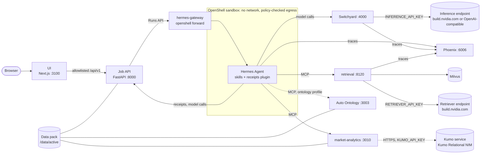
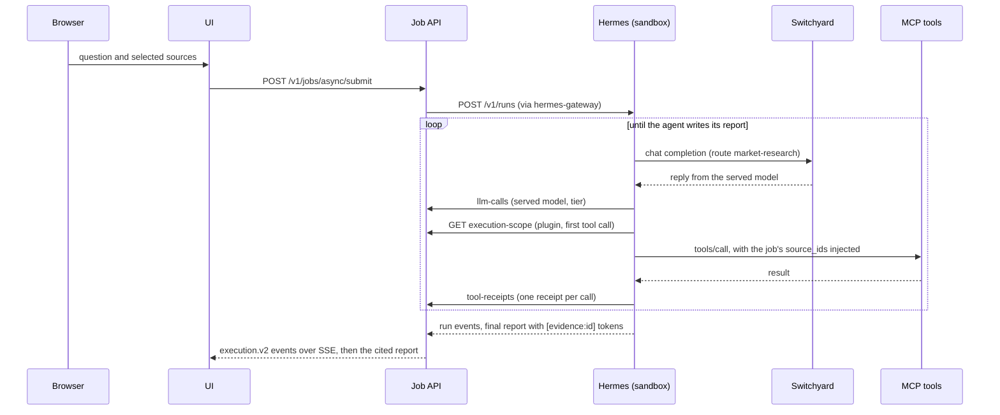

<!--
SPDX-FileCopyrightText: Copyright (c) 2026, NVIDIA CORPORATION & AFFILIATES. All rights reserved.
SPDX-License-Identifier: Apache-2.0
-->

# Architecture

One agent, a handful of tools, and a web UI that shows every step. Hermes Agent runs inside an OpenShell
sandbox. It answers a question by calling MCP tools over the active data pack, and it cites each tool result
it relies on. Every model call leaves the sandbox through Switchyard, which holds the model key and picks the
model. The job API records what happens as typed events and receipts, and the UI draws them as an execution
graph. Everything runs in one Docker Compose project, `market-demo`, driven by `scripts/demo.sh`.

## Components



Every port is published on 127.0.0.1 only (`UI_BIND_HOST` can open the UI's alone to a link that requires
sign-in, such as a Brev link: [operations](operations.md#brev-vm-mode)). The sandbox reaches the services as
`host.openshell.internal`, which the host-networked OpenShell supervisor maps to the host's loopback. The browser
talks only to the UI, which proxies an allowlisted set of API routes.

| Service | Profile | Host port (127.0.0.1) | Role | Code |
|---|---|---|---|---|
| `ui` | core, replay | 3100 (`UI_PORT`) | Next.js web app; proxies an allowlisted `/api/v1/*` to the API; serves the replay bundle | [`ui/`](../ui/README.md) |
| `api` | core | 8000 | FastAPI job service: queue, Hermes runs, `execution.v2` events, receipts, reports, data viewer, CPU/GPU benchmark, voice transcription | [`api/`](../api/README.md) |
| `openshell` | core | 18080 (gRPC/mTLS), 18081 (health) | OpenShell gateway with the Docker compute driver; creates the Hermes sandbox | [`infra/openshell/`](../infra/openshell/README.md) |
| `hermes-gateway` | core | – | `openshell forward service`: the API's way in to Hermes on `127.0.0.1:8642` inside the sandbox | [`infra/openshell/`](../infra/openshell/README.md) |
| Hermes sandbox | – | – | Hermes Agent 0.21.5 with its profile, skills and receipts plugin; created by `demo.sh`, not by Compose | [`agent/`](../agent/README.md) |
| `switchyard` | core | 4000 | Model router; the only holder of `INFERENCE_API_KEY` on the agent path | [`infra/switchyard/`](../infra/switchyard/README.md) |
| `phoenix` | core | 6006 | Arize Phoenix: trace UI and OTLP/HTTP collector | [`infra/phoenix/serve.py`](../infra/phoenix/serve.py) |
| `data` (one-shot) | core | – | Builds the active data pack into the `demo-data` volume at `/data/active` | [`data/`](../data/README.md) |
| `data-fetch` (one-shot) | tools | – | `demo.sh data fetch`: copies or downloads a pack's external datasets into `DATA_SOURCE_DIR`, the only writable mount of it, and verifies them against the pinned manifest | [`data/`](../data/README.md) |
| `milvus`, `data-corpus`, `retrieval-index`, `retrieval` | retrieval | 8120 (`retrieval`) | Document corpus, vector index and the `retrieve_evidence` MCP server | [`tools/retrieval/`](../tools/retrieval/README.md) |
| `milvus-gpu`, `retrieval-benchmark` (one-shot) | analytics-gpu, with retrieval | – | A GPU Milvus holding a `GPU_IVF_FLAT` copy of the index, and the one-shot that times the CPU and GPU indexes for the Benchmark tab, which `demo.sh up` runs after the stack; answers never use or wait on them ([retrieval](retrieval.md#cpugpu-index-comparison-analytics-gpu)) | [`tools/retrieval/`](../tools/retrieval/README.md) |
| `market-analytics` or `market-analytics-gpu` | analytics or analytics-gpu | 3010 | Seven market tools on pandas or RAPIDS (one reads the minute bars in place), plus `predict_asset_outcomes` when Kumo is configured; the GPU service also runs the API's matched CPU/GPU comparisons (`POST /benchmark`) | [`tools/market-analytics/`](../tools/market-analytics/README.md) |
| `auto-ontology-*` | ontology | 3003 (`auto-ontology-mcp`) | NVIDIA Auto Ontology: `ask_question` answers structured questions with SQL | [`tools/auto-ontology/`](../tools/auto-ontology/README.md) |

The `build` and `tools` profiles hold the agent image build, the OpenShell CLI and `data-fetch`, which `demo.sh`
runs. `demo.sh data generate` runs NeMo Data Designer with uv on the host, not in Compose: it rewrites the
`synthetic-market` pack's committed text ([data platform](data-platform.md#the-data-designer-pack)). Named
volumes: `demo-data`, `api-data`, `phoenix-data`, `milvus-data`, `milvus-gpu-data`, `switchyard-data`, `openshell-state`,
`openshell-client` and `auto-ontology-db` (one per data pack).

Kumo prediction is not part of the project: `predict_asset_outcomes` calls a Kumo Relational service that runs on
a GPU host of its own, a NIM behind a key-checking proxy, reached through an HTTPS link with `KUMO_RELATIONAL_URL`
and `KUMO_API_KEY` ([Kumo service](kumo-service.md); its recipe is `infra/kumo-service/`).

## How a question is answered



1. The UI submits the question as a job. The API queues it (one runs, four wait) and starts a Hermes run
   through the Hermes Runs API. The run carries the selected sources and the toolsets they allow: `skills`
   plus the MCP server of each selected capability family (Hermes patch 0002).
2. Hermes sends every model call to Switchyard as the route `market-research`. Switchyard serves it with the
   model its template picks (see [models and routing](models-and-routing.md)) and reports the served model.
3. The `execution-receipts` plugin fetches the job's execution scope from the API once, then injects the
   job's immutable `source_ids` into every data tool call's arguments. After each call it posts a typed
   receipt, and the result the model sees carries the receipt's `evidence_id`.
4. The agent cites receipts as `[evidence:<id>]`. When the run completes, the API waits briefly for any last
   receipts, turns the tokens into numbered citations with a Sources list, and stores the report.
5. Every Hermes event, model call and receipt becomes one `execution.v2` event. The UI follows them over
   Server-Sent Events and draws the graph, the timeline and one explorer per tool call.

### Tool result size

Hermes (v2026.9.24) saves an MCP tool result longer than 50,000 characters to a file the sandboxed agent cannot
read and gives the model a 1,500-character preview instead; when one turn's results together pass 200,000
characters, it does the same to the largest of them. A cut result loses facts the answer needs. Hermes reads the
first limit from `tool_budget.mcp_result_size_chars` in its config, but the stack leaves Hermes' defaults alone and
keeps every result short instead, at most 30,000 characters as the agent reads it: the MCP text, inside Hermes'
JSON envelope, with the plugin's `evidence_id`. Six such results, the most one recorded turn made at once, stay
under the turn budget too.

| Tool | How its result stays under 30,000 characters |
|---|---|
| `retrieve_evidence` | At most 8 whole passages (a passage is one 2,400-character chunk); a result still too long drops its lowest-ranked passages. Every passage it keeps has its full citation. |
| Market tools | Each list is capped (50 `market_scan` assets, 25 anomalies, 30 intraday sessions, 50 news events and 50 assets' news summaries, 100 sentiment periods), then the least important list is shortened while the result is too long: a price series before the per-asset summaries, news events before their per-asset counts. The result's `warnings` summarize the rows left out, and its `*_truncated` flag is set. |
| Any data tool, `ask_question` and `predict_asset_outcomes` included | The `execution-receipts` plugin measures the final string and, past 30,000 characters, drops rows from the end of the longest list (setting the result's own `truncated`), then cuts the longest text, and says what it left out in `shortened_to_fit`. The receipt is built from the whole result. |

Relay, bundled with Hermes, exports the agent's OpenInference spans to Phoenix. Switchyard and the retrieval
server export theirs to the same Phoenix project, so a job's trace shows the agent's turns, the router's
decisions and the retrieval steps together.

## The data plane

```text
DATA_SOURCE_DIR ──data-fetch──▶ /sources (read-only in data, data-corpus and market-analytics)
data/packs/<pack>/ ──data (one-shot)──▶ /data/builds/<pack>@<version>+<profile>+<digest>/  ◀── /data/active
                     data-corpus ─────▶ corpus/documents.jsonl
                     retrieval-index ─▶ Milvus collection + collection-manifest.json
```

Services read `/data/active` (the `demo-data` volume): the API reads `pack.json` and the DuckDB file
(read-only), market analytics reads the Parquet tables, Auto Ontology reads the DuckDB file, and retrieval
reads the index. External datasets, real data that is never committed, stay in `DATA_SOURCE_DIR` on the host:
the builds read them from `/sources`, and `intraday_scan` reads a pack's minute bars there in place, batch by
batch. Swapping data means adding a pack, not changing code. See [data packs](data-packs.md) and
[data platform](data-platform.md).

## Contracts

Services share JSON contracts only; no service imports another's Python code.

| Contract | Defined in | Shared by |
|---|---|---|
| Tool registry: one entry per MCP tool (server, family, label, explorer, receipt kind) | `contracts/tool-registry.json` | API, agent plugin, UI |
| `execution.v2` events, the `ReceiptV2` union (by `artifactKind`) and the Benchmark tab's `Benchmark` and `RetrievalBenchmark` | Pydantic models in `api/src/demo_api/events/`, `receipts/` and `benchmark/`, exported to `contracts/schemas/` and `ui/src/generated/` by `scripts/gen-contracts.sh` | API, UI |
| Data pack layout (`/data/active/pack.json` and friends) | [`data/README.md`](../data/README.md) | every service |
| Market analytics table contract | `tools/market-analytics/contract/market-analytics.v1.json` | the tool and `demo-data validate` |
| Recordings bundle v2 (`index.json`, `pack.json`, `sessions/<id>.json`, `database.json`) | [`api/README.md`](../api/README.md#recordings) | `demo-api record`, the UI's replay mode |

[`contracts/README.md`](../contracts/README.md) describes the events, the receipts and the limits the API
enforces on them.

## Trust boundaries

The demo is a single-user local application. It has no user accounts, so everything it serves stays on the
host's loopback interface, unless `UI_BIND_HOST` opens the UI to a link that requires sign-in. Within that, the agent is
treated as untrusted: it reads documents and tool results that could carry prompt injections.

| Boundary | What enforces it |
|---|---|
| Host network | Every port is published on `127.0.0.1`, except the UI's when `UI_BIND_HOST` is set for a link that requires sign-in (a Brev link with sign-in set in the Brev console). That exposes the UI and its `/api/v1` proxy (job submit, the data viewer's query) with no sign-in; `doctor` warns. Switchyard (no inbound authentication), Phoenix (trace payloads) and the Auto Ontology MCP server (trusted service mode) must never be published further. On a remote host, use an SSH tunnel. |
| Browser → API | The UI proxies only `pack`, `data_sources/**`, job submit, job reads and cancel. `/internal/**` and everything else is a 404. In replay mode the proxy calls nothing. |
| Sandbox network | The sandbox has no network interface. The host-networked OpenShell supervisor makes every connection after checking the policy: each MCP endpoint allows the handshake and an explicit tool list, Switchyard allows chat completions and the model list, the API allows only the three `/internal/hermes` routes, and Phoenix allows only `POST /v1/traces`. Only Hermes' interpreter may connect. |
| Sandbox filesystem | Landlock (a hard requirement): Hermes and the skills are read-only, `HERMES_HOME` and the workspace are writable. The Hermes tools exposed to runs are the skills toolset and the MCP data tools only: no terminal, file, browser or web tools. |
| Secrets | No model key enters the sandbox: Switchyard holds `INFERENCE_API_KEY` and `CAPABLE_API_KEY`, the retrieval server `RETRIEVER_API_KEY` (by default the inference key). The receipt key is an OpenShell placeholder that the supervisor replaces on the `/internal/hermes` routes only. `KUMO_API_KEY` reaches only market analytics, which calls the Kumo service from outside the sandbox. Keys reach services as Compose secrets (files in `/run/secrets`), except Auto Ontology's, which upstream reads from the environment. |
| Per-job scope | Each run gets only the toolsets of its selected sources and cannot widen them (patch 0002). The plugin injects the job's immutable `source_ids` into every data tool call, and the tools refuse other sources. |
| Skills | Skills are baked read-only. `skill_manage` writes are staged and never applied, so an injected document cannot plant a skill for a later job. |
| Database viewer | `POST /v1/data_sources/{id}/query` runs one read-only SELECT in a separate process: 5 s, 100 rows, two at a time. |

`./scripts/demo.sh check` proves the sandbox boundary on the running stack: the placeholder key, blocked
egress, the allowed and denied Switchyard and API routes. [OpenShell](openshell.md) has the details.

The UI has no sign-in and spends your inference credits: anyone who can open a link to it without sign-in can
run the agent on the keys in `.env`. `.env` is created with mode 600 and is gitignored, and `doctor` never
prints a key. A recorded bundle holds questions, answers, evidence excerpts and model names; review it before
committing ([data packs](data-packs.md#recordings)). To report a security issue, use
[NVIDIA's product security process](https://www.nvidia.com/en-us/security/) rather than a public issue.

## Limitations

- **Synthetic market data.** The issuers, prices, events and news are fictional and deterministic, generated
  for a software demonstration. Nothing here is investment advice.
- **Real documents, with their terms.** The SEC EDGAR filings fall under the SEC's reuse terms and may carry
  issuers' own rights, so they are downloaded at build time and never committed. The eCFR is United States
  government information, but not the official legal edition of the CFR ([licenses](data-packs.md#licenses)).
- **Hosted models, with their terms.** Every model call goes to a hosted endpoint and is subject to that
  provider's terms. The default endpoint, build.nvidia.com, is open to anyone with an NVIDIA account but
  serves no GPT model; the `*-gpt` templates take GPT-6.1 Sol from a provider you configure.
- **Auto Ontology is required for the structured questions.** The `ontology` profile needs the
  `vendor/auto-ontology` submodule checked out. Without the profile, the questions that declare it, such
  as the per-sector counts and median returns (`sector-sql`), are not offered, and the agent declines questions
  that need exact rows or custom SQL. The replay
  bundle was recorded with it.
- **Kumo needs its own service.** The Kumo Relational NIM runs on a separate x86_64 host with an NVIDIA GPU
  ([Kumo service](kumo-service.md)). Without its URL and key, the agent has no prediction tool and the Kumo
  questions are not offered.
- **One user.** There are no accounts and no authentication, and one job runs at a time. The demo is for one
  person on one host.
- **Small bake-offs.** The recommendation rests on the 2026-10-01 bake-off: 8 questions over real market data run
  twice for each of 5 arms (16 runs per arm), with two graders that are also among the models compared, so a difference
  of one or two runs is noise. The 2026-09-30 bake-off ran 17 questions twice over 4 arms, with one grader. Their
  limits are in models and routing ([2026-10-01](models-and-routing.md#the-2026-10-01-frontier-bake-off),
  [2026-09-30](models-and-routing.md#limits-of-this-bake-off)).

## Technologies

| Layer | Technology | Version |
|---|---|---|
| Agent | Hermes Agent | 0.21.5 (image `nousresearch/hermes-agent:v2026.9.24`) |
| Sandbox | NVIDIA OpenShell (gateway, supervisor, sandbox, CLI) | 0.1.2 |
| Model router | NVIDIA Switchyard (`switchyard-server`) | 0.3.0 |
| Models (default, build.nvidia.com) | Nemotron 3 Ultra 550B-A55B on every turn; Nemotron 3 Super 120B-A12B for auxiliary calls | hosted |
| Models (with a frontier-model provider) | Nemotron 3 Ultra escalating to GPT-6.1 Sol, judged by GPT-6.1 Sol (`escalation.nemotron-gpt`); Nemotron 3 Super for auxiliary calls | hosted |
| Retrieval models | Nemotron 3 Embed 1B, Llama Nemotron Rerank VL 1B v2 | hosted |
| Retrieval | `langchain-nvidia-ai-endpoints`, `pymilvus`, Milvus (CPU standalone; with analytics-gpu, a GPU standalone for the Benchmark tab's index comparison) | 1.4.3, 2.6.17, 2.6.25 |
| Market analytics | pandas, scikit-learn, NetworkX; on GPU, RAPIDS cuDF, cuML and nx-cugraph | 2.3, 1.9, 3.6; 26.06 (CUDA 12) |
| Prediction | Kumo Relational NIM (on its own host, behind nginx 1.30), `kumo-relational-client` | 1.0.1, 1.0.2 |
| Synthetic data | NeMo Data Designer (`data-designer`) | 0.9.3 |
| Structured questions | NVIDIA Auto Ontology (`ontology` profile, required) | 1.0.0 |
| Tool protocol | Model Context Protocol, Python SDK over streamable HTTP | `mcp` 2.2 |
| Tracing | NeMo Relay (bundled with Hermes), Arize Phoenix | Relay < 0.9, Phoenix 20.16.0 |
| Job API | Python, FastAPI, uvicorn, Pydantic, SQLite, DuckDB | 3.12, 0.141, 0.54, 2.13, –, 1.5.5 |
| UI | Next.js, React, NVIDIA KUI, Zustand, Tailwind CSS | 16.3.7, 18.3, 0.600, 5, 4 |
| Platform | Docker Engine, Docker Compose, uv, Node.js | 28+, 2.30+, 0.12, 22 |

Each keeps its own license, and each model its provider's terms.

## Design rules

- **One lifecycle script.** `scripts/demo.sh` orders the bring-up around the sandbox, which Compose does not
  manage. There is no Makefile.
- **Pinned and reproducible.** Base images and runtime images are pinned by digest, the OpenShell release in
  one file (`infra/openshell/versions.env`), Python dependencies in one `uv.lock` per service (Python 3.12),
  and the UI in `package-lock.json`. A cached rebuild gives the same image ID, so a repeat `up` recreates
  nothing and keeps the sandbox.
- **A shared Docker host.** Every resource belongs to the Compose project `market-demo`, and sandboxes carry
  the OpenShell namespace label `market-demo`. `demo.sh` never removes resources it did not create and never runs
  `--remove-orphans`. It prunes only when asked: `down --prune` removes this project's untagged images and
  Docker's unused build cache, which is host-wide ([disk](operations.md#disk)).
- **Contract first.** A tool is named once in the registry. Event and receipt types are generated from the
  API's models into the UI. Every file naming a tool or an endpoint (the registry, the agent config, the
  sandbox policy, the provider profiles and `compose.yaml`) must agree.
