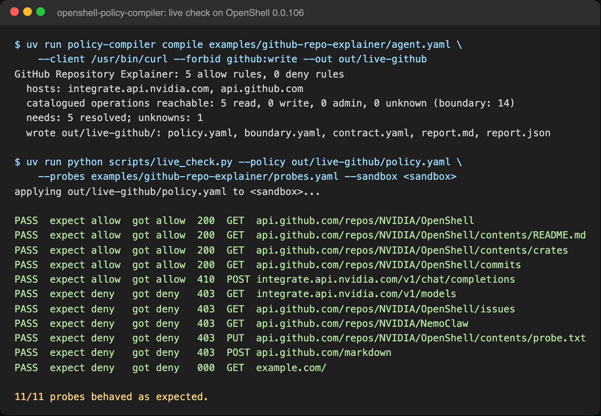
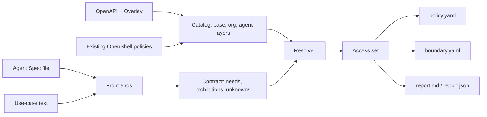

<!-- markdownlint-disable MD013 -->
<!-- SPDX-FileCopyrightText: Copyright (c) 2026 NVIDIA CORPORATION & AFFILIATES. All rights reserved. -->
<!-- SPDX-License-Identifier: Apache-2.0 -->
<!-- markdownlint-enable MD013 -->

# OpenShell Least-Privilege Policy Compiler

| Catalog field | Value |
| --- | --- |
| Description | Compiles an Agent Spec agent definition or a plain-language use case into a least-privilege OpenShell network policy, a boundary policy, and a report that explains every rule. |
| Industry | ✨ Other |
| Requirements | macOS or Linux · Python 3.11+ · uv · Docker and an OpenShell gateway only for the optional live check |
| NemoClaw | N/A |
| Harness | N/A |
| OpenShell | 0.0.106 |

Writing an OpenShell policy file is easy. Knowing what belongs in it is hard:
which hosts, which HTTP methods and paths, which binaries, and which of those
calls read data versus change it. This proof of concept compiles that answer
from the agent's own definition and from knowledge about the APIs it calls. It
writes a policy that is as narrow as the declared calls allow, a wider boundary
policy for review and approval workflows, and a report that names the evidence
for every rule.

> [!IMPORTANT]
> This is a proof of concept. Review every generated rule before you apply it.
> A generated policy is only as accurate as the agent definition and the
> catalog it was compiled from.

## Screenshot



The policy compiled from [`examples/github-repo-explainer/agent.yaml`](examples/github-repo-explainer/agent.yaml)
was applied to a throwaway OpenShell 0.0.106 sandbox. Requests the agent
declares were allowed. OpenShell denied everything else with `policy_denied`:
other repositories, issues, writes, GitHub's read-level `POST /markdown`, the
inference host's undeclared `GET /v1/models`, and undeclared hosts. Searchable
form of the result: `11/11 probes behaved as expected.`

## At A Glance

| Question | Answer |
| --- | --- |
| Category | Developer Tool |
| Contributor or provenance | NVIDIA |
| Use this when | You need an OpenShell network policy for an agent and want each rule to trace back to something the agent declares. |
| You will get | `policy.yaml`, `boundary.yaml`, `contract.yaml`, `report.md`, and `report.json` for each compile, plus breadth and lint reports for existing policies. |
| Runs on | macOS or Linux with Python 3.11 or later. |
| Requires | [uv](https://docs.astral.sh/uv/). The live check also requires Docker, the `openshell` CLI, and a running OpenShell gateway. |
| Verified on | macOS 26 (Apple silicon), Python 3.13, uv 0.11, OpenShell CLI and gateway 0.0.106. |
| Evidence level | integration |
| Support and maturity | Proof of concept. Best-effort community support; see the [support policy](../../../SUPPORT.md). |
| External access, data, and actions | Compiling makes no network requests. The live check creates and deletes a sandbox on your gateway and sends unauthenticated requests to `api.github.com`, `integrate.api.nvidia.com`, and `example.com`. |
| Start here | [Quickstart](#quickstart) |
| Confirm success | [Verification](#verification) |

## Quickstart

Run these commands from the repository root:

```bash
cd examples/tools/openshell-policy-compiler
uv sync
uv run policy-compiler compile examples/github-repo-explainer/agent.yaml \
  --client /usr/bin/python3 \
  --forbid github:write
```

`--client` names the real path of the binary that sends the agent's requests.
OpenShell matches binaries by their resolved path, so use the path that
`readlink -f "$(command -v python3)"` prints inside your sandbox image.
`--forbid github:write` adds a prohibition that no generated rule may break.

Expected output:

```text
GitHub Repository Explainer: 5 allow rules, 0 deny rules
  hosts: integrate.api.nvidia.com, api.github.com
  catalogued operations reachable: 5 read, 0 write, 0 admin, 0 unknown (boundary: 14)
  needs: 5 resolved; unknowns: 1
  wrote out/github-repo-explainer/: policy.yaml, boundary.yaml, contract.yaml, report.md, report.json
```

The generated `policy.yaml` allows only the declared calls, pinned to one
repository:

```yaml
network_policies:
  nvidia_integrate:
    name: nvidia_integrate
    endpoints:
      - host: integrate.api.nvidia.com
        port: 443
        protocol: rest
        enforcement: enforce
        rules:
          - allow:
              method: POST
              path: /v1/chat/completions
    binaries:
      - path: /usr/bin/python3
  github_rest:
    name: github_rest
    endpoints:
      - host: api.github.com
        port: 443
        protocol: rest
        enforcement: enforce
        rules:
          - allow:
              method: GET
              path: /repos/NVIDIA/OpenShell
          - allow:
              method: GET
              path: /repos/NVIDIA/OpenShell/contents/**
          - allow:
              method: GET
              path: /repos/NVIDIA/OpenShell/commits
          - allow:
              method: GET
              path: /search/code
    binaries:
      - path: /usr/bin/python3
```

Open `out/github-repo-explainer/report.md` to see why each rule exists, what
the compiler could not see (here, the opaque `summarize_architecture` server
tool), and how the policy compares with its boundary.

## Verification

**Evidence level:** integration

Run the test suite from the tool directory:

```bash
uv run pytest -o addopts="" -q
```

**Expected result:**

```text
NNN passed
```

The suite includes a round trip of every OpenShell policy file in this
repository through the lifter and lowerer, and compiles both examples.

To check enforcement in a live sandbox, compile with the probe binary as the
client, then run the live check. The check sends real, unauthenticated requests
from inside the sandbox. It creates a sandbox named `opc-live-<time>` on your
current gateway and deletes it when it finishes; pass `--sandbox NAME` to use an
existing sandbox instead.

```bash
uv run policy-compiler compile examples/github-repo-explainer/agent.yaml \
  --client /usr/bin/curl --forbid github:write --out out/live-github
uv run python scripts/live_check.py \
  --policy out/live-github/policy.yaml \
  --probes examples/github-repo-explainer/probes.yaml
```

**Expected result:**

```text
| PASS | allow | allow | 200 | GET https://api.github.com/repos/NVIDIA/OpenShell | get_repository tool |
| PASS | allow | allow | 200 | GET https://api.github.com/repos/NVIDIA/OpenShell/contents/README.md | read_file tool |
| PASS | allow | allow | 200 | GET https://api.github.com/repos/NVIDIA/OpenShell/contents/crates | read_file tool, directory listing |
| PASS | allow | allow | 200 | GET https://api.github.com/repos/NVIDIA/OpenShell/commits | list_commits tool |
| PASS | allow | allow | 410 | POST https://integrate.api.nvidia.com/v1/chat/completions | the model call (upstream rejects it without an API key) |
| PASS | deny | deny | 403 | GET https://integrate.api.nvidia.com/v1/models | the agent never lists models |
| PASS | deny | deny | 403 | GET https://api.github.com/repos/NVIDIA/OpenShell/issues | issues are not part of this agent |
| PASS | deny | deny | 403 | GET https://api.github.com/repos/NVIDIA/NemoClaw | a different repository |
| PASS | deny | deny | 403 | PUT https://api.github.com/repos/NVIDIA/OpenShell/contents/probe.txt | writing is never declared |
| PASS | deny | deny | 403 | POST https://api.github.com/markdown | a read-level POST the agent does not declare |
| PASS | deny | deny | 000 | GET https://example.com/ | a host the agent never declares |

11/11 probes behaved as expected.
```

An upstream error such as `410` on an allowed probe is expected: the request
reached the provider without credentials. A denied probe returns OpenShell's
`policy_denied` body, or no HTTP response (`000`) when the connection is
refused.

**This verifies:** that the compiled policy is accepted by OpenShell 0.0.106,
allows the declared requests, and denies undeclared methods, paths,
repositories, and hosts for the probe binary.

**This does not verify:** that a running agent completes its task under the
policy, behavior on other OpenShell versions, Linux hosts, or the boundary
policy with the OpenShell prover, which is not installed in the verified
environment.

## How It Works



1. A front end reads the agent definition and writes a **contract**: each
   network call the agent declares (a *need*), each thing it must never do (a
   *prohibition*), and each thing the compiler cannot see (an *unknown*, such
   as a server-side tool whose code is not in the definition).
2. The **capability graph** describes APIs: services and their hosts,
   operations (method and path template), the provider-defined capabilities
   each operation requires, cross-provider concepts such as
   `source-code.read`, and client binaries such as `git`.
3. The **resolver** matches each need to graph operations, keeps the literal
   path segments the agent declares (for example one repository), gives
   operations that only `git` performs to `git` alone, removes anything a
   prohibition forbids, and drops matchers that another matcher already covers.
4. The **OpenShell back end** writes the policy. Every endpoint sets `protocol`
   and `enforcement: enforce` explicitly, because OpenShell ignores `access`
   and `rules` without a protocol and defaults to audit without `enforcement`.

The design, including every decision taken while building this proof of
concept, is in [`docs/design.md`](docs/design.md). The catalog format is in
[`docs/catalog-format.md`](docs/catalog-format.md).

## Inputs

### Agent Spec

The compiler reads [Oracle Open Agent Spec](https://github.com/oracle/agent-spec)
YAML or JSON directly. It does not require the `pyagentspec` package, so unknown
plugin components become unknowns instead of errors.

| Agent Spec component | Becomes |
| --- | --- |
| `RemoteTool`, `ApiNode` | A need for the URL's host, method, and path template. `url_allow_list` limits the paths. A templated host without an allow list becomes an unknown. |
| `OpenAiCompatibleConfig`, `VllmConfig`, `OllamaConfig` | A need for `POST <url>/v1/chat/completions` (or `/responses`). |
| `OpenAiConfig`, `GeminiConfig`, `OciGenAiConfig` | A need for the provider host. Agent Spec adapters ignore `OpenAiConfig.url`. |
| `MCPToolBox`, `MCPTool` over HTTP | MCP rules for `initialize`, `notifications/initialized`, `tools/list`, and `tools/call` for each filtered tool. |
| `A2AAgent` | A need for the agent URL. |
| Postgres datastore | A connection-level need for the database host and port. |
| `ServerTool`, `BuiltinTool`, stdio MCP | An unknown. Nothing is granted. The report suggests concepts from the description. |

### A use case in plain language

```bash
uv run policy-compiler from-use-case \
  "I need access to code in GitHub so that I can understand NVIDIA/OpenShell" \
  --client /usr/bin/python3 --client /usr/bin/git
```

USECASE_OUTPUT_PLACEHOLDER

### Your own APIs

To add an API that only your organization can reach, describe it with an
OpenAPI spec and an [OpenAPI Overlay](https://spec.openapis.org/overlay/v1.0.0.html)
that records what the spec does not say. The overlay uses these annotations:

| Annotation | Meaning |
| --- | --- |
| `x-openshell-allowed-ips` | Private address ranges. OpenShell blocks private addresses unless an endpoint lists them. |
| `x-openshell-privilege` | `read`, `write`, or `admin`, when the HTTP method is misleading (for example a `POST` search). |
| `x-openshell-capability` | The capability an operation belongs to. |
| `x-openshell-concepts` | Concepts the operation realizes, for use-case matching. |
| `x-openshell-inspection` | `opaque` when OpenShell cannot inspect the traffic, such as client-certificate mTLS. |

```bash
cd examples/internal-orders-api
uv run policy-compiler import openapi openapi.yaml --overlay overlay.yaml \
  --provider-id acme --provider-name "ACME internal services" \
  --out catalog/acme-orders.yaml
uv run policy-compiler compile agent.yaml --catalog catalog \
  --client /usr/bin/python3 --forbid acme:admin
```

The generated endpoint carries `allowed_ips: [10.20.0.0/16]`, allows
`POST /v1/orders/search` as a read because the overlay says so, and never allows
`DELETE`. The report notes that `cancel_order` asks for confirmation, which
OpenShell cannot do in the middle of a request, and that the API key header
should be bound with an OpenShell provider.

Keep your catalog directory in a private repository. Pass it with `--catalog`;
the compiler never uploads it.

### Existing policies

`explain` lifts existing OpenShell policies, lists lint findings, and counts
the catalogued operations each policy can reach:

```bash
scripts/survey_repo_policies.sh
```

The script explains the 23 policy files in this repository and mines their
hosts into a catalog. For example, a policy that opens `api.github.com` with
`tls: skip` reaches every GitHub operation in the catalog, including deleting a
repository, because OpenShell cannot inspect that traffic.

## Outputs

| File | Contents |
| --- | --- |
| `policy.yaml` | The least-privilege network policy. With `--base-policy`, the filesystem, process, and Landlock sections come from that file. |
| `boundary.yaml` | The same capabilities without resource scope. Use it as the ceiling for `openshell-prover check` or for Policy Advisor auto-approval. |
| `contract.yaml` | The internal contract, for debugging. |
| `report.md`, `report.json` | Every rule with its operations and reasons, needs, unknowns, widenings, prohibitions, diagnostics, and breadth metrics. |

Apply a policy to a sandbox with:

```bash
openshell policy get <sandbox> --base > base.yaml
uv run policy-compiler compile <agent.yaml> --client <binary-path> --base-policy base.yaml
openshell policy set <sandbox> --policy out/<agent>/policy.yaml --wait
```

## Known Limitations

- The compiler sees only what the agent declares. Server-side tools, stdio MCP
  servers, and the runtime's own traffic (telemetry, package installs) appear
  as unknowns, not rules. Observing a running agent is a later phase.
- The base catalog is a hand-curated slice of GitHub, GitLab, NVIDIA, and OpenAI
  APIs. Import GitHub's full permission data with
  `policy-compiler import github-permissions`.
- GitHub's flat permission data cannot distinguish "either permission" from
  "both permissions". The importer requires all listed permissions when GitHub
  marks additional permissions, which can under-grant.
- Query, header, and body constraints are not generated. `GET /search/code`
  therefore allows searching all of GitHub, not one repository.
- The semantic layer uses keyword matching, not embeddings. Its suggestions are
  never granted automatically.
- `tls: terminate` is accepted by OpenShell 0.0.106 but rejected by newer
  OpenShell builds. `lift` reports it as `legacy-tls-value`.

## Teardown

Compiling writes only to `out/`. Remove it with `rm -r out`. The live check
deletes the sandbox it creates unless you pass `--keep`.

## Third-Party Dependencies

| Package | Use | License |
| --- | --- | --- |
| [PyYAML](https://pyyaml.org/) | Reading and writing YAML | MIT |
| [pytest](https://pytest.org/) (development only) | Tests | MIT |
